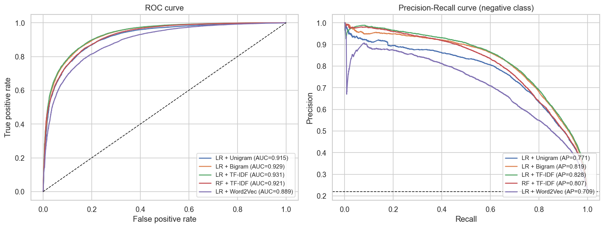
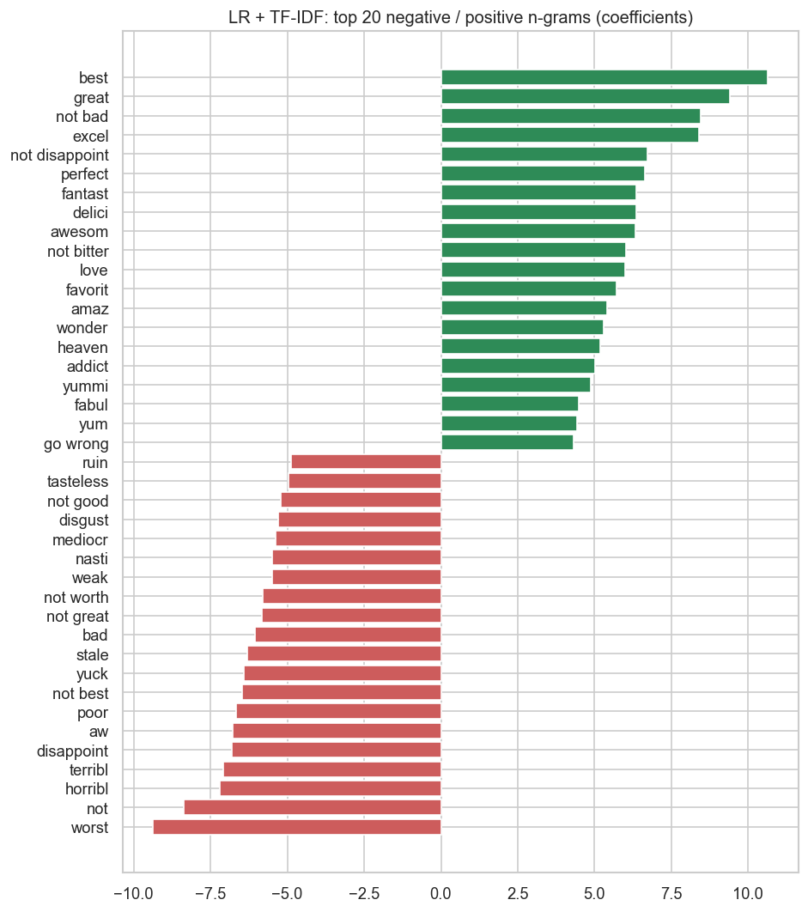

# Amazon Fine Food Reviews: Sentiment Classification

Predict whether an Amazon food review is **positive** or **negative** from its one-line `Summary`, using classic NLP features (bag-of-words, bigrams, TF-IDF, Word2Vec) and scikit-learn classifiers.

* **Data:** [Amazon Fine Food Reviews](https://www.kaggle.com/snap/amazon-fine-food-reviews) (568,454 reviews, 1999-2012)
* **Target:** `positive` if `Score > 3`, otherwise `negative`
* **Best model:** TF-IDF (uni + bigrams) + Logistic Regression, **ROC AUC 0.931**, accuracy 89.5%

## Results

Test set: 78,614 reviews (20% stratified hold-out).

| Model | ROC AUC | Accuracy | Precision (neg) | Recall (neg) | F1 (neg) |
|---|---|---|---|---|---|
| **LR + TF-IDF** | **0.931** | **0.895** | **0.835** | 0.651 | 0.732 |
| LR + Bigram counts | 0.929 | 0.895 | 0.827 | **0.659** | **0.733** |
| Random Forest + TF-IDF | 0.921 | 0.887 | 0.800 | 0.649 | 0.716 |
| LR + Unigram counts | 0.915 | 0.881 | 0.803 | 0.607 | 0.691 |
| LR + averaged Word2Vec | 0.89 | 0.86 | 0.75 | 0.51 | 0.61 |



About 78% of the reviews are positive, so the negative class is the hard one. Raising the decision threshold from 0.5 to **0.63** raises negative-class recall from 0.65 to 0.74 and F1 from 0.732 to 0.750, with almost no change in accuracy.

### What the model learned



* Bigrams capture negation: *"not bad"*, *"not disappoint"* and *"not bitter"* are strong **positive** signals, while *"not good"*, *"not worth"* and *"not great"* are negative. This works because negations are **kept** when stop words are removed (NLTK's default list would drop them).
* Strongest positive stems: *best, great, excel(lent), perfect, fantast(ic), delici(ous)*. Strongest negative: *worst, horribl(e), terribl(e), disappoint, aw(ful), stale*.

## Approach

1. **Cleaning:** drop empty summaries and duplicate reviews posted under several product variants (568k to 394k rows, which prevents identical rows landing in both train and test); lower-case, strip punctuation, remove stop words except negations, Porter stemming ([`preprocess.py`](preprocess.py)).
2. **Features:** unigram counts, uni+bigram counts, uni+bigram TF-IDF (`min_df=5`), and 100-dim Word2Vec trained on the training set and averaged per summary.
3. **Models:** Logistic Regression and Random Forest, each wrapped in a scikit-learn `Pipeline` so the vectorizer is fit on training data only.
4. **Evaluation:** ROC AUC, precision / recall / F1 per class, precision-recall curve, confusion matrix, threshold tuning.
5. **Interpretation:** LR coefficients (direction + strength) and Random Forest `feature_importances_`.
6. **Deployment:** the best pipeline and its tuned threshold are saved with `joblib` and reloaded for inference without retraining.

The full analysis is in [`amazon_review_solution.ipynb`](amazon_review_solution.ipynb).

## Project structure

```
.
├── amazon_review_solution.ipynb   # end-to-end analysis
├── preprocess.py                  # text cleaning shared by training and inference
├── predict.py                     # command-line inference with the saved model
├── sentiment_model.joblib         # trained TF-IDF + Logistic Regression pipeline
├── *.png                          # figures used in this README
└── requirements.txt
```

## Quick start

```bash
pip install -r requirements.txt
python predict.py "Absolutely delicious, will buy again!" "Stale and overpriced"
```

```
positive  P(positive)=0.973  Absolutely delicious, will buy again!
negative  P(positive)=0.004  Stale and overpriced
```

To reproduce the analysis, download `Reviews.csv` from [Kaggle](https://www.kaggle.com/snap/amazon-fine-food-reviews) into the project root and run the notebook (about 1 minute on a laptop):

```bash
jupyter notebook amazon_review_solution.ipynb
```

## Limitations and next steps

* The single word *not* is a strong negative feature, so very short phrases like *"Not bad"* (P = 0.60) can still be misclassified. Using the full review `Text` or a contextual model (e.g. a fine-tuned transformer) should help.
* Score 3 reviews are labeled negative as specified; treating them as a separate neutral class, or dropping them, would give a cleaner binary task.
* Hyper-parameters (regularization `C`, `min_df`, n-gram range) were not tuned with cross-validation.

## License

[MIT](LICENSE)
